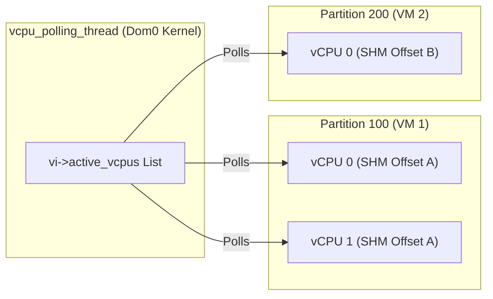

# Design Document: Multi-Partition Tachyon VMM Architecture

## Status
- **Author**: avagin@
- **Status**: Implemented
- **Target Components**: 
  - Tachyon VMM (`cloud-hypervisor/tachyon`)
  - Virtio KVM Device Backend (`cloud-hypervisor/virtio-devices/src/virtio_kvm.rs`)
  - Linux `virtio-vm` Kernel Driver (`tachyon/drivers/virtio/virtio-vm/`)

---

## 1. Objective & Motivation

### 1.1 Problem Statement
Currently, Tachyon operates as a single-instance VMM daemon in L0 that proxies KVM capabilities to a single Dom0 (L1) environment through a singular `/dev/kvm` character device. In this monolithic model:
- All guest VMs, vCPUs, memory files, and eventfds share a single global handle registry and process context in L0.
- A failure, crash, or restart of the single Tachyon daemon abruptly terminates all nested workloads.
- Multitenancy and strict hardware/resource isolation boundaries cannot be enforced at the L0 daemon level.

### 1.2 Goals
1. **Support Multiple L0 Tachyon Partitions**: Enable running multiple independent Tachyon daemons in L0, each identified by a unique 64-bit identifier (`partition_id` / `tachyon_id` / `uid`).
2. **Strict Resource & Fault Isolation**: Ensure that all resources (KVM VM file descriptors, vCPU states, memory regions/memfds, eventfds, IRQ routing tables, and RPC sockets) belonging to one Tachyon partition are strictly isolated and never shared with or accessible by other partitions.
3. **Dom0 Control Interface**: Introduce a new control character device in Dom0 (e.g., `/dev/tachyon-ctrl` or `/dev/virtio-kvm-ctrl`) supporting an ioctl that takes a `partition_id` (`u64`) argument to dynamically instantiate a dedicated partition device.
4. **Dynamic Partition KVM Device (`/dev/tachyon-<partition-id>/kvm`)**: Each created device `/dev/tachyon-<partition-id>/kvm` operates identically to a standard `/dev/kvm` device, transparently routing all KVM ioctls and memory operations to the corresponding L0 Tachyon partition.
5. **Seamless Lifecycle Management**: Provide robust reference counting, dynamic creation and teardown, error handling for absent or crashing L0 daemons, and support for Save/Restore (S/R) per partition.

### 1.3 Non-Goals
- **Cross-Partition Resource Sharing**: VMs, memory regions, or vCPUs will not be shared across different Tachyon partitions under any circumstances.
- **Dynamic Partition ID Re-assignment**: A running `/dev/tachyon-<partition-id>/kvm` device is immutably bound to its `partition_id` for its entire lifetime.

---

## 2. Terminology & System Architecture

### 2.1 Terminology
- **Partition**: An independent instance of the Tachyon VMM daemon running in L0, uniquely identified by a 64-bit `partition_id` (`u64`), owning its own KVM device handle registry, VFIO assignments, and memory allocations.
- **Dom0 (Control Partition)**: The privileged management VM in L1 where the `virtio-vm` kernel driver and user-space management tooling execute.
- **Partition KVM Device (`/dev/tachyon-<partition-id>/kvm`)**: A dynamic character device node automatically created in `devtmpfs` under `/dev/tachyon-<partition-id>/` representing a specific L0 Tachyon partition's KVM subsystem.
- **Partition VFIO Container (`/dev/tachyon-<partition-id>/vfio/vfio`)**: A dynamic character device node representing the partition's VFIO Type1 IOMMU container.
- **Partition VFIO Group Devices (`/dev/tachyon-<partition-id>/vfio/<group_id>`)**: Dynamic character device nodes representing assigned host VFIO device groups directly accessible to the partition.
- **Control Device (`/dev/tachyon-ctrl`)**: The Dom0 management character device used to create, query, and destroy partition devices.
- **`vkvmfs` (Virtual KVM Filesystem)**: The guest memory filesystem in Dom0 supporting partition-scoped memory allocations (`-o partition=<partition_id>`).

### 2.2 End-to-End Architecture

```mermaid
graph TD
    subgraph Dom0_Userspace ["Dom0 Userspace (L1)"]
        VMM_A["VMM Instance A (Cloud Hypervisor / QEMU)"]
        VMM_B["VMM Instance B (Cloud Hypervisor / QEMU)"]
        AdminTool["Management Tool / Orchestrator"]
    end

    subgraph Dom0_Kernel ["Dom0 Linux Kernel (virtio-vm Driver)"]
        DevCtrl["/dev/tachyon-ctrl<br/>(Control Device)"]
        DevKvmA["/dev/tachyon-100/kvm<br/>(Partition Device: ID 100)"]
        DevVfioA["/dev/tachyon-100/vfio/vfio<br/>/dev/tachyon-100/vfio/22"]
        DevKvmB["/dev/tachyon-200/kvm<br/>(Partition Device: ID 200)"]
        DevVfioB["/dev/tachyon-200/vfio/vfio<br/>/dev/tachyon-200/vfio/35"]
        DevKvmDefault["/dev/kvm<br/>(Default Partition: ID 0)"]
        
        VirtioDriverCore["virtio-vm Driver Core<br/>(Partition Registry, SHM Polling, Maple Tree BAR Allocator)"]
    end

    subgraph L0_Hypervisor ["L0 VMM (Cloud Hypervisor)"]
        VirtioKvmDevice["virtio-kvm PCI Device<br/>- BAR4 Physical Mapping<br/>- VQ Request Multiplexer<br/>- TachyonConnectionPool"]
    end

    subgraph L0_Tachyon_Partitions ["L0 Host Userspace (Tachyon Partitions)"]
        TachyonA["Tachyon Partition 100<br/>- System Registry (Handle 1..N)<br/>- KVM FDs & Memfds<br/>- VFIO Groups (e.g. Group 22)<br/>- Dedicated Unix Socket"]
        TachyonB["Tachyon Partition 200<br/>- System Registry (Handle 1..N)<br/>- KVM FDs & Memfds<br/>- VFIO Groups (e.g. Group 35)<br/>- Dedicated Unix Socket"]
    end

    subgraph L0_KVM ["L0 Host Linux Kernel"]
        KvmHost["/dev/kvm (Physical Host KVM Subsystem)"]
        VfioHost["/dev/vfio/* (Host VFIO Subsystem)"]
    end

    AdminTool -->|ioctl(CREATE_PARTITION, 100)| DevCtrl
    AdminTool -->|ioctl(CREATE_PARTITION, 200)| DevCtrl
    DevCtrl -->|Registers| DevKvmA
    DevCtrl -->|Registers| DevVfioA
    DevCtrl -->|Registers| DevKvmB
    DevCtrl -->|Registers| DevVfioB

    VMM_A -->|open & KVM/VFIO ioctls| DevKvmA
    VMM_A -->|open & VFIO ioctls| DevVfioA
    VMM_B -->|open & KVM/VFIO ioctls| DevKvmB
    VMM_B -->|open & VFIO ioctls| DevVfioB

    DevKvmA --> VirtioDriverCore
    DevVfioA --> VirtioDriverCore
    DevKvmB --> VirtioDriverCore
    DevVfioB --> VirtioDriverCore
    DevKvmDefault --> VirtioDriverCore

    VirtioDriverCore -->|Virtqueue Commands with partition_id| VirtioKvmDevice

    VirtioKvmDevice -->|RPC over /run/tachyon/100.sock| TachyonA
    VirtioKvmDevice -->|RPC over /run/tachyon/200.sock| TachyonB

    TachyonA -->|ioctl| KvmHost
    TachyonA -->|ioctl| VfioHost
    TachyonB -->|ioctl| KvmHost
    TachyonB -->|ioctl| VfioHost
```

---

## 3. Subsystem Detailed Designs

### 3.1 L0 Tachyon Partition Lifecycle & Identity

Each Tachyon partition in L0 is started with a unique 64-bit partition identifier and optional configuration protobuf:

```bash
# Launching independent Tachyon partitions in L0:
tachyon --partition-id 100 --socket /run/tachyon/100.sock --config /etc/tachyon/partition-100.bin
tachyon --partition-id 200 --socket /run/tachyon/200.sock --config /etc/tachyon/partition-200.bin
```

#### Key Characteristics:
1. **Isolated Handle Registries**: Each Tachyon partition process maintains its own independent `System` struct and atomic `NEXT_HANDLE_ID` counter. Handles inside Partition A (e.g., Handle `1` for `KvmDevice`, Handle `2` for `VM`, Handle `3` for `Vcpu`, Handle `4` for `VfioGroup`) are completely independent of handles in Partition B.
2. **Dedicated RPC Endpoints**: Each Tachyon partition listens on a distinct Unix domain socket (deterministic scheme: `/run/tachyon/<partition_id>.sock` or `/tmp/tachyon-<partition_id>.sock`).
3. **Partition Configuration**: Loaded at startup via `--config`, specifying assigned VFIO groups and hardware resource allowances.
4. **LUO & S/R Scoping**: During live updates or kexec Save/Restore, state serialization files and LUO preserved FDs are qualified by `partition_id` (e.g., `/var/lib/tachyon/state-100.bin`), preventing any cross-contamination.

---

### 3.2 L0 Cloud Hypervisor `virtio-kvm` Multi-Partition Connection Pool & Routing

The `virtio-kvm` device running in the L0 hypervisor acts as the intermediary between the guest virtqueue and the set of L0 Tachyon partition daemons.

#### 3.2.1 `TachyonConnection` & Dynamic Partition Socket Resolution
`VirtioKvm` manages dynamic partition RPC connections via `TachyonConnection`:

```rust
#[derive(Clone)]
pub struct TachyonConnection {
    socket_dir: PathBuf,
    partitions: Arc<Mutex<HashMap<u64 /* partition_id */, TachyonPartition>>>,
}

impl TachyonConnection {
    pub fn new(socket_dir: PathBuf) -> Self {
        TachyonConnection {
            socket_dir,
            partitions: Arc::new(Mutex::new(HashMap::new())),
        }
    }

    fn socket_for_partition(&self, partition_id: u64) -> PathBuf {
        self.socket_dir.join(format!("{partition_id}.sock"))
    }

    pub fn prepare_partition(
        &self,
        virtio_kvm: &VirtioKvmEpollHandler,
        partition_id: u64,
    ) -> io::Result<TachyonPartition> {
        let mut partitions = self.partitions.lock().unwrap();
        if let Some(partition) = partitions.get(&partition_id) {
            Self::prepare_connection(partition.client(), virtio_kvm);
            return Ok(partition.clone());
        }
        let sock_path = self.socket_for_partition(partition_id);
        let new_conn = Arc::new(Self::connect(&sock_path)?);
        Self::prepare_connection(&new_conn, virtio_kvm);
        let partition = TachyonPartition::new(partition_id, new_conn);
        partitions.insert(partition_id, partition.clone());
        Ok(partition)
    }

    pub fn get_partition(&self, partition_id: u64) -> io::Result<TachyonPartition> {
        let mut partitions = self.partitions.lock().unwrap();
        if let Some(partition) = partitions.get(&partition_id) {
            return Ok(partition.clone());
        }
        let sock_path = self.socket_for_partition(partition_id);
        let client = Arc::new(Self::connect(&sock_path)?);
        let partition = TachyonPartition::new(partition_id, client);
        partitions.insert(partition_id, partition.clone());
        Ok(partition)
    }

    pub fn call_partition(&self, partition_id: u64, msg: Message) -> io::Result<Message> {
        let partition = self.get_partition(partition_id)?;
        partition.call(msg)
    }
}
```

#### 3.2.2 Guest Handle Scoping and Resolution
The guest driver sends requests identified by a 64-bit guest-visible handle. To ensure partition isolation:
1. **Resource Table Association**: Each `VirtioKvmResource` entry in `resources: Arc<VmResourceMap>` stores:
   - `partition_id: u64`: Identifies which Tachyon partition owns the backend resource.
   - `tachyon_handle: u64`: The handle ID within that specific Tachyon partition.
   - `connection: Arc<TachyonConnection>`: The active RPC channel.
2. **Top-Level Open Routing**:
   - When `VIRTIO_VM_OPEN` is dispatched, the request includes `partition_id` in `req.arg`.
   - `VirtioKvm` fetches/connects to the appropriate `TachyonConnection`, allocates a new guest-level handle, and binds it to that `partition_id`.
3. **Subsequent Command Routing**:
   - All subsequent commands (`KVM_CREATE_VM`, `KVM_RUN`, `VIRTIO_VM_DEVICE_MMAP`, etc.) look up the target `VirtioKvmResource` by `req.handle`.
   - The resource immediately provides the corresponding `TachyonConnection` and remote `tachyon_handle`, ensuring zero ambiguity and zero risk of cross-partition misrouting.

---

### 3.3 Virtio Protocol & Wire Format Specification

The wire format for `virtio-kvm` maintains backwards compatibility while enabling explicit multi-partition addressing.

#### 3.3.1 Request Struct
```c
struct virtio_kvm_req {
    __le64 handle;     /* Guest handle ID (or -1 for device-level commands) */
    __le64 operation;  /* VIRTIO_VM_OPEN, VIRTIO_VM_IOCTL, etc. */
    __le64 arg;        /* Operation argument / partition_id during OPEN/CREATE */
    __le64 longarg;    /* Physical pointer / data buffer */
} __attribute__((packed));
```

#### 3.3.2 Operation Semantics for Multi-Partition
| Operation | `req.handle` | `req.arg` | `req.longarg` | Description |
| :--- | :--- | :--- | :--- | :--- |
| `VIRTIO_VM_OPEN` | `-1ULL` | `partition_id` (`u64`) | `0` | Opens a new KVM device session bound to `partition_id`. Returns guest handle in `resp.data`. |
| `VIRTIO_VM_MEMORY_FILE_CREATE` | `-1ULL` | `partition_id` (`u64`) | `__pa(h)` | Creates a guest memory `memfd` within the specified Tachyon partition. |
| `VIRTIO_VM_VFIO_OPEN` | `-1ULL` | `partition_id` (`u64`) | `0` | Opens a new VFIO Type1 IOMMU container bound to `partition_id`. |
| `VIRTIO_VM_VFIO_GROUP_OPEN` | `-1ULL` | `partition_id` (`u64`) | `group_id` (`u64`) | Opens host VFIO group `group_id` directly within the specified Tachyon partition. |
| `VIRTIO_VM_VFIO_GET_GROUPS` | `-1ULL` | `partition_id` (`u64`) | `__pa(groups_buf)` | Queries the list of configured host VFIO groups for `partition_id`. |
| `VIRTIO_VM_IOCTL` | `<handle>` | `ioctl_cmd` | `__pa(arg)` | Standard ioctl execution on a partition resource (VM, vCPU, KVM dev, VFIO dev/group/container). |
| `VIRTIO_VM_DEVICE_MMAP` | `<handle>` | `0` | `__pa(mmap_dev)` | Maps a memory file/SHM into BAR4 for the handle's associated partition. |
| `VIRTIO_VM_CLOSE` | `<handle>` | `0` | `0` | Closes and cleans up the resource in the respective partition. |

---

### 3.4 Dom0 Linux Kernel Driver (`virtio-vm`)

The `virtio-vm` driver in Dom0 is extended to provide both the control device and dynamic partition devices.

#### 3.4.1 Control Device (`/dev/tachyon-ctrl`)
#### 3.4.1 Control Device (`/dev/tachyon-ctrl`)
The driver registers a misc device named `tachyon-ctrl` in `drivers/virtio/virtio-vm/common.c` during module initialization:

```c
/* UAPI Definition: drivers/virtio/virtio-vm/common.h */

#define TACHYON_CTRL_IO 0xAE

/* Create a new /dev/tachyon-<partition_id>/kvm device */
#define TACHYON_IOC_CREATE_PARTITION   _IO(TACHYON_CTRL_IO, 0x01)

/* Destroy an existing /dev/tachyon-<partition_id>/kvm device */
#define TACHYON_IOC_DESTROY_PARTITION  _IO(TACHYON_CTRL_IO, 0x02)
```

#### 3.4.2 Partition Device Representation & Lifecycle
The driver maintains a list of active partition structures managing KVM and VFIO device nodes:

```c
struct virtio_kvm_partition {
    u64 partition_id;
    char name[32];                    /* "tachyon-<partition_id>-kvm" (sysfs) */
    char nodename[64];                /* "tachyon-<partition_id>/kvm" (devtmpfs) */
    struct miscdevice misc_dev;       /* /dev/tachyon-<partition_id>/kvm */
    struct miscdevice vfio_container_dev; /* /dev/tachyon-<partition_id>/vfio/vfio */
    char vfio_container_name[32];
    char vfio_container_nodename[64];
    struct list_head vfio_groups;     /* Active struct virtkvm_vfio_group devices */
    struct list_head link;
    struct virtkvm_info *vi;
    atomic_t refcnt;                  /* Active resource reference count */
};
```

#### 3.4.3 Device Creation & Teardown Flow
1. **Creation (`TACHYON_IOC_CREATE_PARTITION`)**:
   - Userspace issues `ioctl(ctrl_fd, TACHYON_IOC_CREATE_PARTITION, partition_id)`.
   - Driver acquires `vi->partition_lock` and verifies that `partition_id` is not already registered (`-EEXIST` on collision).
   - Driver allocates `struct virtio_kvm_partition`, initializes `atomic_set(&part->refcnt, 0)`.
   - Registers `/dev/tachyon-<partition_id>/kvm` via `virtkvm_partition_init_kvm()`.
   - Initializes partition VFIO support via `virtkvm_partition_init_vfio()`:
     - Registers the container device node `/dev/tachyon-<partition_id>/vfio/vfio`.
     - Sends `VIRTIO_VM_VFIO_GET_GROUPS` to query available host VFIO group IDs for this partition.
     - Dynamically registers a misc device for each returned group ID as `/dev/tachyon-<partition_id>/vfio/<group_id>`.
   - Adds the partition to `vi->partitions`.

2. **Opening Partition Devices & Reference Counting**:
   - Every active resource holding or referencing partition capabilities increments `part->refcnt`:
     - Open file descriptors on `/dev/tachyon-<partition_id>/kvm` (`struct virtio_kvm_dev_ctx`)
     - Active VMs created via `KVM_CREATE_VM` (`struct virtio_kvm_vm`)
     - Memory files / `vkvmfs` superblocks (`struct kvm_guest_memory_file`, `struct vkvmfs_fs_info`)
     - Partition eventfds (`struct virtio_kvm_eventfd`)
     - VFIO container file handles (`struct virtkvm_vfio_container`)
     - VFIO group file handles (`struct virtkvm_vfio_group`)
     - VFIO device file handles (`struct virtkvm_vfio_device`)

3. **Teardown (`TACHYON_IOC_DESTROY_PARTITION`)**:
   - Driver acquires `vi->partition_lock` and finds the partition by `partition_id` (`-ENOENT` if not found).
   - **Strict Resource Safety**: Checks `atomic_read(&part->refcnt) > 0`. If any partition resources are still active, returns `-EBUSY` and refuses destruction.
   - Unlinks partition from `vi->partitions` and drops `vi->partition_lock`.
   - Cleans up and deregisters all `/dev/tachyon-<partition_id>/vfio/<group_id>` group devices via `virtkvm_partition_cleanup_vfio()`.
   - Deregisters `/dev/tachyon-<partition_id>/vfio/vfio`.
   - Deregisters `/dev/tachyon-<partition_id>/kvm` via `virtkvm_partition_cleanup_kvm()`.
   - Frees `struct virtio_kvm_partition`.

#### 3.4.4 Userspace Management Tool (`virtio-vm-ctl`)
The `virtio-vm-ctl` CLI (`tachyon/src/bin/virtio-vm-ctl.rs`) provides user-space commands to manage partitions via `/dev/tachyon-ctrl`:

```bash
# Create partition device node /dev/tachyon-100/kvm
virtio-vm-ctl partition-create 100

# Destroy partition device
virtio-vm-ctl partition-destroy 100
```

---

### 3.5 Memory Architecture & Partition Isolation

#### 3.5.1 BAR4 Physical Offset Partitioning
All Tachyon partitions share the physical PCI BAR4 exposed by the `virtio-kvm` PCI device. Dom0 manages this space uniformly using a Maple Tree (`vi->allocinfo.mt`):

```
+-------------------------------------------------------------------------------+
|                             PCI BAR4 Address Space                            |
+-----------------------+-----------------------+-------------------------------+
| Partition 100 Memfd / | Partition 200 Memfd / | Partition 100 SHM /           |
| Guest RAM Region      | Guest RAM Region      | vCPU Polling Region           |
| (phys_offset A)       | (phys_offset B)       | (phys_offset C)               |
+-----------------------+-----------------------+-------------------------------+
```

1. **Collision-Free Offsets**: Dom0's kernel allocator assigns distinct, non-overlapping `phys_offset` ranges to every memory file and vCPU shared memory region regardless of the partition.
2. **Host-Side Isolation**:
   - When Partition 100 calls `VIRTIO_VM_DEVICE_MMAP` for `phys_offset A`, L0 Cloud Hypervisor instructs Tachyon Partition 100 to map its `memfd` to `BAR_base + phys_offset A`.
   - Tachyon Partition 200 has no access to `phys_offset A` because Tachyon 200's process does not map that range into its virtual address space.
   - Page table protections at both L0 host and Dom0 levels ensure total physical and virtual memory isolation.

#### 3.5.2 Multi-Partition `vkvmfs` Memory Files
For filesystem-backed guest memory (`vkvmfs`), mount options specify the target partition:
```bash
mount -t vkvmfs none /mnt/vkvmfs-100 -o partition=100
```
When files are created in `/mnt/vkvmfs-100`, allocations automatically route to Tachyon Partition 100.

---

### 3.6 High-Performance Shared Memory vCPU Polling

The `virtio-vm` driver uses a background kthread (`vcpu_polling_thread`) to poll `KVM_RUN` completions via shared memory without RPC round-trip overhead.

#### Multi-Partition Polling Design:


- Each active `virtio_kvm_vcpu` across all partitions is inserted into `vi->active_vcpus` when `KVM_RUN` is submitted.
- The polling thread iterates through `active_vcpus`, directly inspecting each vCPU's `vcpu->vm->shm->vcpus[vcpu_id].state`.
- Since each VM's SHM pointer (`vcpu->vm->shm`) points directly to its unique memory-mapped BAR offset, the single polling thread services vCPUs across all partitions concurrently with zero cross-partition lock contention.

---

### 3.7 Save/Restore (S/R) & Live Update in Multi-Partition Environments

#### 3.7.1 Independent Partition Snapshots
Because each Tachyon partition daemon is an independent process, Save/Restore operations can be executed on a per-partition basis:
- **Individual Live Update**: `tachyonctl liveupdate --partition-id 100 --tachyon-bin /usr/bin/tachyon_v2` updates Tachyon Partition 100 without pausing or impacting Partition 200.
- **State Image Isolation**: The state image protobuf stream for Partition `X` is written to `tachyon_state_<partition_id>.bin`.

#### 3.7.2 Cloud Hypervisor `virtio-kvm` State Serialization
When Dom0 snapshotting is performed, the `VirtioKvmState` structure serializes resources, memory files, and eventfds with their owning `partition_id`:

```rust
#[derive(Serialize, Deserialize)]
pub enum VirtioKvmResourceTypeState {
    System {
        partition_id: u64,
    },
    Vm {
        tachyon_handle: u64,
        shm_bar_offset: u64,
        partition_id: u64,
    },
    Vcpu {
        vcpu_id: u32,
        vm_handle: u64,
        tachyon_handle: u64,
        partition_id: u64,
    },
    Stats {
        parent_handle: u64,
        partition_id: u64,
    },
}

#[derive(Serialize, Deserialize)]
pub struct VirtioKvmResourceState {
    pub handle: u64,
    pub resource_type: VirtioKvmResourceTypeState,
}

#[derive(Serialize, Deserialize)]
pub struct EventfdState {
    pub ctx: u64,
    pub refs: u32,
    pub tachyon_handle: u64,
    pub partition_id: u64,
}

#[derive(Serialize, Deserialize)]
pub struct KvmMemoryFileState {
    pub handle: u64,
    pub size: u64,
    pub phys_offset: u64,
    pub tachyon_handle: u64,
    pub partition_id: u64,
}

#[derive(Serialize, Deserialize)]
pub struct VirtioKvmState {
    pub avail_features: u64,
    pub acked_features: u64,
    pub next_handle_id: u64,
    pub resources: Vec<VirtioKvmResourceState>,
    pub eventfds: Vec<EventfdState>,
    pub mem_files: Vec<KvmMemoryFileState>,
    pub mappings: Vec<KvmBarMappingState>,
}
```

During restore, `VirtioKvm` routes descriptor requests (`GetFileDescriptor`, etc.) to the respective partition connection and re-attaches live-update notification handlers across all active partition connections in `activate()`.

---

### 3.8 Partition Configuration Protobuf Schema

Each Tachyon partition can be launched with a configuration protobuf passed via `--config <path>`:

```protobuf
syntax = "proto3";

package tachyon_config;

message MemoryDescriptor {
  enum MemoryType {
    ANONYMOUS = 0;
    TMPFS = 1;
    HUGETLBFS = 2;
    PMEM = 3;
  }
  optional MemoryType type = 1;
  repeated string path = 2;
}

message NumaNode {
  optional int32 id = 1;
  repeated uint64 cpu = 2;
  optional MemoryDescriptor memory = 3;

  message VfioDevice {
    optional uint64 group = 1;
  }
  repeated VfioDevice vfio_devices = 4;
}

message VmOptions {
  repeated NumaNode nodes = 1;
}
```

#### Key Aspects:
- **Startup Loading**: `tachyon/src/main.rs` parses the JSON or binary proto into `tachyon::VmOptions` (aliased as `tachyon::Config`) and sets `System::config`.
- **Group Restricting & Advertising**: The `System` registry aggregates all VFIO devices across all configured NUMA nodes via `VmOptions::vfio_groups()` to answer `VfioGetGroups` RPCs, informing Dom0 about the specific device groups allocated to the partition.

---

### 3.9 Partition-Scoped VFIO Subsystem

To support pass-through devices within multi-partition environments without device number collisions:

#### 3.9.1 Direct Host Group & Device Passthrough (No Remapping)
- The guest driver avoids synthetic group ID remapping (`group0`, `group1`, etc.).
- When host group `22` is assigned to Partition `100`, the guest kernel creates `/dev/tachyon-100/vfio/22`.
- Opening `/dev/tachyon-100/vfio/22` dispatches `VIRTIO_VM_VFIO_GROUP_OPEN` with `req.arg = 100` (`partition_id`) and `req.longarg = 22` (`group_id`). L0 Tachyon opens `/dev/vfio/22` directly on the host.

#### 3.9.2 Dynamic Group Enumeration on Partition Creation
- When `virtkvm_partition_create(vi, partition_id)` is invoked:
  1. Registers the partition container device node `/dev/tachyon-<partition_id>/vfio/vfio`.
  2. Issues `VIRTIO_VM_VFIO_GET_GROUPS` to L0 over virtqueue with a buffer pointer.
  3. L0 `virtio-kvm` routes `VfioGetGroups` to Tachyon Partition `<partition_id>`, which returns its configured VFIO group list.
  4. Dom0 dynamically registers character devices for all returned group IDs under `/dev/tachyon-<partition_id>/vfio/<group_id>`.

#### 3.9.3 VFIO Container & Group Association
- Opening `/dev/tachyon-<partition_id>/vfio/vfio` creates a partition-bound container handle.
- The `VFIO_GROUP_SET_CONTAINER` ioctl binds the group to the container in Tachyon.
- `VFIO_GROUP_GET_DEVICE_FD` copies the requested device PCI address string from userspace and returns an anonymous file descriptor referencing the backend device handle in Tachyon.
- Interrupt routing and eventfds are tracked per partition via `virtio_kvm_get_evfd(device->partition_id, eventfd)`.

---

## 4. Error Handling, Edge Cases, & Security

### 4.1 L0 Partition Daemon Unavailability / Crash
- **Scenario**: Userspace opens `/dev/tachyon-300/kvm`, but Tachyon Partition `300` is not running in L0.
- **Handling**:
  - `VIRTIO_VM_OPEN` sent over virtqueue returns `ECONNREFUSED` or `ENODEV`.
  - `open("/dev/tachyon-300/kvm")` fails immediately and returns `-ENODEV` to userspace.
- **Crash During Execution**:
  - If Tachyon Partition `100` exits abruptly, RPC calls fail with `EPIPE`/`ECONNRESET`.
  - Pending `KVM_RUN` requests are terminated with `EIO`, and Dom0 marks the VM as faulted while other partitions continue uninterrupted.

### 4.2 Namespace & Access Control
- `/dev/tachyon-<partition_id>/kvm` character devices can be assigned custom ownership, permissions, and SELinux/AppArmor labels via standard `udev` rules:
  ```udev
  KERNEL=="tachyon-[0-9]*-kvm", GROUP="kvm", MODE="0660"
  ```
- This allows Dom0 orchestrators to grant specific containerized or unprivileged tenants access to only their designated Tachyon partition directory and device.

### 4.3 Concurrent Partition Device Creation
- Race conditions during `TACHYON_IOC_CREATE_PARTITION` are prevented via a mutex-protected lookup in Dom0 and atomic registration in `misc_register()`.

---

## 5. Implementation Status & Rollout Plan

### Phase 1: Dom0 Kernel Driver UAPI & Control Device (Completed)
- Defined UAPI ioctl commands in `tachyon/drivers/virtio/virtio-vm/common.h` (`TACHYON_IOC_CREATE_PARTITION`, `TACHYON_IOC_DESTROY_PARTITION`).
- Implemented `tachyon-ctrl` misc device in `drivers/virtio/virtio-vm/common.c`.
- Implemented dynamic `/dev/tachyon-<partition_id>/kvm` and `/dev/tachyon-<partition_id>/vfio/*` device registration, context binding, and reference count protection (`-EBUSY` on active resources).

### Phase 2: L0 `virtio-kvm` Dynamic Routing & S/R (Completed)
- Implemented `TachyonConnection` partition routing in `cloud-hypervisor/virtio-devices/src/virtio_kvm.rs`.
- Routed `partition_id` through `VIRTIO_VM_OPEN`, `VIRTIO_VM_MEMORY_FILE_CREATE`, `VIRTIO_VM_EVENTFD_GET`, and VFIO group/container handlers.
- Preserved `partition_id` across `VirtioKvmState` (resources, memory files, eventfds) and restored partition connections and live-update notification handlers in `activate()`.

### Phase 3: Tachyon Daemon Multi-Instance, VFIO Config & CLI (Completed)
- Added `--partition-id <uid>`, `--config <path>`, and `--socket <dir_or_file>` command-line arguments to `cloud-hypervisor/tachyon/src/main.rs`.
- Defined `tachyon_config::Config` protobuf schema and implemented `VIRTIO_VM_VFIO_GET_GROUPS` RPC handler in `KvmDeviceOps`.
- Added `virtio-vm-ctl` CLI (`tachyon/src/bin/virtio-vm-ctl.rs`) for partition management.

### Phase 4: Testing & Verification
1. **Multi-Partition Concurrency Test**: Start multiple Tachyon partitions in L0, create `/dev/tachyon-<id>/kvm` devices in Dom0, and launch simultaneous VMs across all partitions.
2. **Isolation Test**: Inject a crash (`kill -9`) into a Tachyon Partition and verify that VMs on other partition devices experience zero disruption.
3. **Live Update Test**: Perform a live update on one partition while other partitions are under heavy vCPU load.
